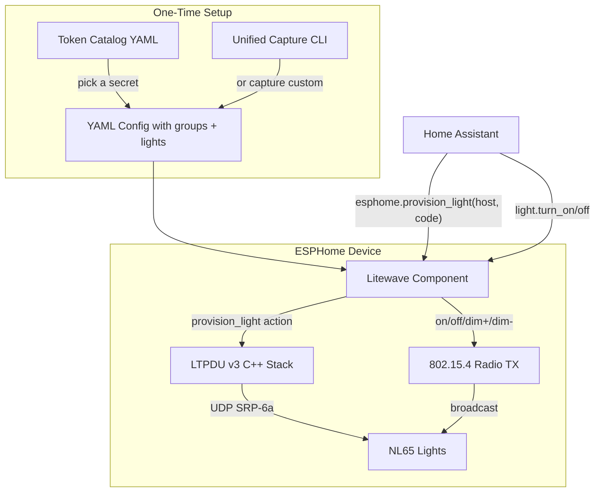

# Plan: Litewave ESPHome Component Redesign

## Context

The project reverse-engineers the Nanoleaf Litewave protocol for per-room light control via an ESP32-C6. The current ESPHome component supports on/off only, with tokens manually captured via a sniffer. The proven approach is **cryptographic room isolation** -- writing different `sp/ss` shared secrets to different lights so they respond to different tokens, without needing to understand the token derivation algorithm.

### Key Findings from Exploration

- **Existing component** (components/litewave/): Supports on/off with manually captured seq/token pairs. No dim support, no provisioning.
- **BLE write tool** (tools/ble\_write\_ss.py): Writes `sp/ss` to a Sense+ switch via BLE (X25519 + AES-CTR encrypted LTPDU). Cross-platform via bleak.
- **Light provisioning** (tools/provision\_v3.py + tools/ltpdu\_v3.py): Provisions lights via LTPDU v3 over UDP (SRP-6a + AES-CTR/CCM). \~675 lines of Python.
- **Capture tool** (tools/capture\_tokens.py): Captures on/off tokens via ESP32-C6 sniffer firmware. Needs extension for dim+/dim-.
- **Dim button behavior**: Unknown -- needs investigation before committing to schema. May be single-burst like on/off, or continuous stream.

### Target Architecture



---

## Task 1: Unified 4-Button Capture CLI Tool

### 1a. Investigate dim button behavior

Before building the capture tool, use sniff mode to determine if dim+/dim- produce the same frame structure as on/off:

- Flash sniffer firmware to ESP32-C6
- Run `capture.py --debug` and press dim+/dim- buttons
- Check: same FCF? Same payload structure (TTL + cmd\_type + 14-byte token + trailer)? Is `cmd_type` still `0x00` or a different value?
- Document findings

**If dim buttons use the same frame structure**, they can be captured and replayed identically to on/off -- just different seq/token pairs.

**If dim buttons use a different frame structure** (e.g., continuous stream, different cmd\_type), we need a different approach for dim control. The plan below assumes they match on/off structure; we will adapt if investigation reveals otherwise.

### 1b. Build unified capture tool

Create `tools/capture_and_provision.py` -- a single CLI that handles the complete per-room setup:

```
Usage: python3 capture_and_provision.py \
    --switch-name "Nanoleaf Wireless SW 1D9" \
    --switch-code "0242-362-0007" \
    --secret <108-char-hex | "auto"> \
    --group-name kitchen \
    [--port /dev/cu.usbmodem1101]
```

Workflow:

1. Generate or accept a 54-byte shared secret
2. Write it to the Sense+ switch via BLE (reuse `ble_write_ss.py` logic)
3. Prompt user: "Press the ON button on the Sense+ switch"
4. Capture ON seq/token from sniffer
5. Prompt: "Press the OFF button"
6. Capture OFF seq/token
7. Prompt: "Press the DIM+ button" (if dim investigation confirms compatibility)
8. Capture DIM+ seq/token
9. Prompt: "Press the DIM- button"
10. Capture DIM- seq/token
11. Output YAML config block and save to file

The tool combines functionality from `ble_write_ss.py` (BLE write) and `capture_tokens.py` (sniffer capture) into one guided flow. It reuses the existing serial protocol for sniffer communication and the bleak-based BLE write.

**Critical files:**

- tools/capture\_tokens.py -- base for sniffer capture logic (lines 30-208)
- tools/ble\_write\_ss.py -- base for BLE write logic (lines 38-83, 136-218)

---

## Task 2: Automated Token Catalog Generator

Create `tools/generate_catalog.py` that automates the capture loop for 100 pre-defined shared secrets:

### Shared secret generation

Secrets are 54 bytes. Generate them deterministically starting from index 0:

```python
# Index 0: 54 bytes of zeros
# Index 1: 53 bytes of zeros + 0x01
# Index 99: 53 bytes of zeros + 0x63
def secret_for_index(i):
    return bytes(53) + bytes([i])
```

### Automated loop

```
For i in 0..99:
    1. Compute secret = secret_for_index(i)
    2. Write secret to switch via BLE (auto-reconnect; switch needs button press for BLE advertising)
    3. Print "Press ON button" -> capture
    4. Print "Press OFF button" -> capture
    5. Print "Press DIM+ button" -> capture (if applicable)
    6. Print "Press DIM- button" -> capture (if applicable)
    7. Append entry to catalog
    8. Print progress (e.g., "12/100 complete")
```

### Catalog file format

Store as `token_catalog.yaml` in the repo root:

```yaml
# Pre-generated Litewave token catalog
# Each entry maps a deterministic shared_secret to its captured tokens.
# Users can pick any entry and skip the manual capture process.
#
# Shared secrets are 54 bytes, generated as: 53 zero bytes + index byte.
# Tokens were captured from a Sense+ switch programmed with each secret.

entries:
  - index: 0
    shared_secret: "0000000000...00"  # 108 hex chars
    on_sequence: 0xFB
    on_token: "949B16B63E32024A9DD73E03604D"
    off_sequence: 0xFD
    off_token: "9ACC50F8E109757695C384C4EA74"
    dim_plus_sequence: 0x03
    dim_plus_token: "..."
    dim_minus_sequence: 0x05
    dim_minus_token: "..."
  - index: 1
    shared_secret: "0000000000...01"
    # ...
```

### Resume support

The tool should support resuming from the last completed index if interrupted (check existing entries in the output file).

---

## Task 3: Update ESPHome Config Schema and C++ Component

### New YAML structure

```yaml
litewave:
  channel: 26
  pan_id: 0x3B71
  groups:
    - id: living_room
      shared_secret: "0000000000...00"  # 54 bytes hex, for provisioning
      on_sequence: 0xFB
      on_token: "949B16B63E32024A9DD73E03604D"
      off_sequence: 0xFD
      off_token: "9ACC50F8E109757695C384C4EA74"
      dim_plus_sequence: 0x03        # NEW
      dim_plus_token: "..."          # NEW
      dim_minus_sequence: 0x05       # NEW
      dim_minus_token: "..."         # NEW
      lights:                        # NEW - for provisioning
        - name: "Downlight 1"
          host: "192.168.1.50"       # or IPv6
          pairing_code: "1640-700-5590"
        - name: "Downlight 2"
          host: "192.168.1.51"
          pairing_code: "2750-811-6601"
```

### Python schema changes (components/litewave/**init**.py)

Add new config keys:

```python
CONF_SHARED_SECRET = "shared_secret"
CONF_DIM_PLUS_SEQUENCE = "dim_plus_sequence"
CONF_DIM_PLUS_TOKEN = "dim_plus_token"
CONF_DIM_MINUS_SEQUENCE = "dim_minus_sequence"
CONF_DIM_MINUS_TOKEN = "dim_minus_token"
CONF_LIGHTS = "lights"
CONF_NAME = "name"
CONF_HOST = "host"
CONF_PAIRING_CODE = "pairing_code"
```

Update `GROUP_SCHEMA`:

```python
LIGHT_SCHEMA = cv.Schema({
    cv.Required(CONF_NAME): cv.string_strict,
    cv.Required(CONF_HOST): cv.string_strict,
    cv.Required(CONF_PAIRING_CODE): cv.string_strict,
})

GROUP_SCHEMA = cv.Schema({
    cv.Required(CONF_ID): cv.declare_id(LitewaveGroup),
    cv.Optional(CONF_SHARED_SECRET): validate_shared_secret,  # 54 bytes hex
    cv.Required(CONF_ON_SEQUENCE): cv.hex_uint8_t,
    cv.Required(CONF_ON_TOKEN): validate_token,
    cv.Required(CONF_OFF_SEQUENCE): cv.hex_uint8_t,
    cv.Required(CONF_OFF_TOKEN): validate_token,
    cv.Optional(CONF_DIM_PLUS_SEQUENCE): cv.hex_uint8_t,
    cv.Optional(CONF_DIM_PLUS_TOKEN): validate_token,
    cv.Optional(CONF_DIM_MINUS_SEQUENCE): cv.hex_uint8_t,
    cv.Optional(CONF_DIM_MINUS_TOKEN): validate_token,
    cv.Optional(CONF_LIGHTS, default=[]): cv.ensure_list(LIGHT_SCHEMA),
})
```

Register new actions:

```python
@automation.register_action("litewave.send_dim_plus", LitewaveSendDimPlusAction, ...)
@automation.register_action("litewave.send_dim_minus", LitewaveSendDimMinusAction, ...)
```

### C++ changes

**components/litewave/litewave.h** -- Extend `LitewaveGroup`:

```cpp
class LitewaveGroup {
 public:
    // Existing: on/off seq + token setters/getters
    void set_dim_plus_sequence(uint8_t seq) { dim_plus_seq_ = seq; }
    void set_dim_plus_token(const uint8_t token[LITEWAVE_TOKEN_LEN]) { ... }
    void set_dim_minus_sequence(uint8_t seq) { dim_minus_seq_ = seq; }
    void set_dim_minus_token(const uint8_t token[LITEWAVE_TOKEN_LEN]) { ... }
    
    void set_shared_secret(const uint8_t *ss, size_t len) { ... }
    bool has_dim_plus() const { return has_dim_plus_; }
    bool has_dim_minus() const { return has_dim_minus_; }

    // Light info for provisioning
    struct LightInfo {
        std::string name;
        std::string host;
        std::string pairing_code;
    };
    void add_light(const LightInfo &light) { lights_.push_back(light); }
    const std::vector<LightInfo> &get_lights() const { return lights_; }
    const uint8_t *get_shared_secret() const { return shared_secret_; }
    size_t get_shared_secret_len() const { return shared_secret_len_; }

 protected:
    // Existing fields + new ones
    uint8_t dim_plus_seq_{0};
    uint8_t dim_plus_token_[LITEWAVE_TOKEN_LEN]{};
    uint8_t dim_minus_seq_{0};
    uint8_t dim_minus_token_[LITEWAVE_TOKEN_LEN]{};
    bool has_dim_plus_{false};
    bool has_dim_minus_{false};
    uint8_t shared_secret_[54]{};
    size_t shared_secret_len_{0};
    std::vector<LightInfo> lights_;
};
```

**components/litewave/litewave.cpp** -- Add `send_dim_plus()` and `send_dim_minus()` methods (identical pattern to `send_on`/`send_off`).

**components/litewave/automation.h** -- Add `LitewaveSendDimPlusAction` and `LitewaveSendDimMinusAction` classes (same pattern as existing action classes).

---

## Task 4: Implement LTPDU v3 Protocol in C++

Port the Python LTPDU v3 stack to C++ for running on the ESP32. This enables the device to provision lights directly without a computer.

### Architecture

Create new files in `components/litewave/`:

```
components/litewave/
  ltpdu_v3.h          # SRP-6a + session + transport classes
  ltpdu_v3.cpp         # Implementation
```

### Components to port

| Python source                                 | C++ target             | ESP-IDF dependency                 |
| --------------------------------------------- | ---------------------- | ---------------------------------- |
| `SRP6aClient` (lines 232-306 of ltpdu\_v3.py) | `SRP6aClient` class    | `mbedtls_mpi` for big integer math |
| `CrcEncryptedSession` (lines 312-327)         | `CrcSession` class     | `mbedtls_aes` + CTR mode           |
| `CcmEncryptedSession` (lines 330-362)         | `CcmSession` class     | `mbedtls_ccm`                      |
| `UdpTransport` (lines 395-419)                | `UdpTransport` class   | lwIP sockets                       |
| `LtpduV3Session` (lines 429-593)              | `LtpduV3Session` class | Ties everything together           |
| TLV encoding/parsing                          | Helper functions       | Pure C++                           |
| V3 binary framing                             | Helper functions       | Pure C++                           |

### SRP-6a implementation notes

The Python code uses a 512-bit prime (`SRP_NG_512`). In C++ with mbedTLS:

```cpp
// Key operations needed:
mbedtls_mpi N, g, a, A, B, k, u, x, S;
mbedtls_mpi_read_string(&N, 10, "11229916235553671...");  // 512-bit prime
mbedtls_mpi_lset(&g, 2);
mbedtls_mpi_fill_random(&a, 64, mbedtls_ctr_drbg_random, &ctr_drbg);
mbedtls_mpi_exp_mod(&A, &g, &a, &N, NULL);  // A = g^a mod N
// ... rest of SRP-6a protocol
```

The 512-bit prime keeps the modular exponentiation fast on ESP32 (much faster than the 2048-bit alternative also defined in the Python code).

### Session encryption

- **AES-CTR** (v3.0): Use `mbedtls_aes_crypt_ctr()` -- straightforward
- **AES-CCM** (v3.1/v3.2): Use `mbedtls_ccm_encrypt_and_tag()` / `mbedtls_ccm_auth_decrypt()`

### Async execution

The provisioning operation involves network I/O (multiple UDP round-trips) and CPU-intensive crypto (SRP-6a modular exponentiation). It must not block the ESPHome main loop. Approach:

- Run provisioning in a FreeRTOS task (`xTaskCreate`)
- Report progress via ESP\_LOGI logging
- Set a status flag that the main component can expose as a text sensor

### Estimated scope

\~400-600 lines of C++ (the SRP-6a math is verbose but mechanical). The Python library is 675 lines; C++ will be similar but with more boilerplate for memory management.

---

## Task 5: Wire Up ESPHome provision\_light Action

### Option A: User-defined API action (simplest)

In the user's YAML:

```yaml
api:
  actions:
    - action: provision_light
      variables:
        group_name: string
        light_host: string
        light_pairing_code: string
      then:
        - lambda: |-
            // Look up group by name, get shared_secret
            // Call C++ provisioning function
            id(litewave_comp).provision_light(
                light_host, light_pairing_code, group_name);
```

This approach uses the ESPHome `api: actions:` mechanism. The user calls `esphome.<node>_provision_light` from HA with the host, pairing code, and group name.

### Option B: Component-registered action (more integrated)

Register a proper action in the component Python code:

```python
LITEWAVE_PROVISION_SCHEMA = cv.Schema({
    cv.GenerateID(): cv.use_id(LitewaveComponent),
    cv.Required(CONF_GROUP_ID): cv.use_id(LitewaveGroup),
    cv.Required("light_index"): cv.int_range(min=0),
})

@automation.register_action(
    "litewave.provision_light",
    LitewaveProvisionAction,
    LITEWAVE_PROVISION_SCHEMA,
)
```

This reads the host/pairing\_code from the group's lights list by index, keeping the YAML clean:

```yaml
button:
  - platform: template
    name: "Provision Kitchen Light 1"
    on_press:
      - litewave.provision_light:
          group: kitchen
          light_index: 0
```

### Recommendation

**Use Option B** (component-registered action). It is more ESPHome-idiomatic, keeps provisioning details in the litewave config block, and avoids requiring the user to manually pass secrets around in lambda code. The light's host, pairing\_code, and the group's shared\_secret are all already in the YAML config.

The action's C++ implementation spawns a FreeRTOS task that:

1. Retrieves the group's shared\_secret and light's host/pairing\_code
2. Creates a `LtpduV3Session`
3. Authenticates via SRP-6a PairingCode
4. Writes `sp/ss` to the light
5. Optionally writes `sp/pi`, `sp/mc`, `sp/admin`
6. Verifies readback
7. Logs success/failure

---

## Verification

### Task 1 verification

- Run the unified capture tool against a real Sense+ switch
- Confirm all 4 tokens are captured correctly
- Verify captured tokens replay successfully via `lw_replay.py`

### Task 2 verification

- Generate at least a few catalog entries
- Pick one, provision a light with its shared\_secret, verify the cataloged tokens control the light

### Task 3 verification

- Compile the updated ESPHome component (`esphome compile example.yaml`)
- Verify dim\_plus/dim\_minus actions transmit correct frames (check with sniffer)
- Verify backward compatibility (config without dim/lights still works)

### Task 4 verification

- Unit test SRP-6a against known test vectors from the Python implementation
- Test provisioning a light from the ESP32 (compare with Python tool results)

### Task 5 verification

- Call the provision action from HA
- Verify the light's `sp/ss` changes (read back via Python tool)
- Verify the light responds to the group's tokens after provisioning

## Critical Files

- components/litewave/**init**.py -- Config schema, code generation, action registration
- components/litewave/litewave.h -- Group and component class definitions
- components/litewave/litewave.cpp -- TX implementation, main component logic
- tools/ltpdu\_v3.py -- Reference implementation for the C++ LTPDU v3 port
- tools/capture\_tokens.py -- Base for the unified capture tool
